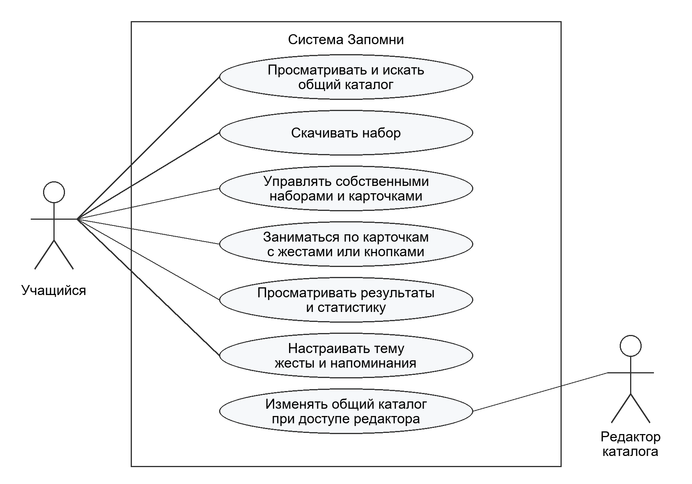

# Техническое задание приложения Запомни

Практика 2 · Версия 0.1 · 4 ноября 2026 года

## 1 Назначение и границы

«Запомни» предназначено для студентов и школьников, повторяющих термины, определения и иностранные слова. Приложение организует занятия по карточкам и хранит расписание повторений. Удобство управления движением телефона подлежит проверке на устройстве; рост успеваемости или скорости запоминания не заявляется.

MVP включает серверный каталог, поиск, скачивание, собственные наборы и карточки, занятия, интервальное повторение, жесты и кнопки, результаты, локальную статистику, темы и напоминания. Регистрация учащегося не требуется. Собственные материалы и прогресс остаются на устройстве. Чаты, рейтинги, подписки, ИИ-генерация и межустройственная синхронизация исключены.

**Участники:** учащийся работает в Android-приложении; редактор изменяет общий каталог через защищённый API. Редакторский интерфейс внутри APK не входит в MVP. Собственный FastAPI-сервер предоставляет общий каталог; его соответствие требованию внешней интеграции практики 10 ещё требует ответа преподавателя.

## 2 Состав экранов

Выделены семь самостоятельных экранов. Каждый получает собственные ViewModel и UiState; формы и подтверждения внутри экрана являются состояниями, а не отдельными экранами.

| Экран | Назначение и переходы | Применимые состояния |
| --- | --- | --- |
| Каталог | Поиск; переход к содержимому набора | Загрузка, данные, пусто, ошибка сети, офлайн |
| Мои наборы | Собственные и скачанные; создание, удаление, переход к статистике | Загрузка, данные, пусто, ошибка локального чтения |
| Содержимое набора | Карточки, скачивание или начало занятия; переход к редактору своего набора | Данные, пусто, загрузка, ошибка, скачано |
| Редактор материала | Название и описание набора; список карточек; форма добавления или изменения карточки | Новая запись, изменение, ошибки полей, сохранение, ошибка БД |
| Занятие | Вопрос, ответ, оценка, выход с подтверждением | Вопрос, ответ, сохранение, ошибка, нечего повторять, жесты недоступны |
| Результаты и статистика | Итог последнего занятия и общие показатели; переход из занятия или Моих наборов | Данные, нет истории, ошибка БД |
| Настройки | Тема, жесты, напоминания и время | Данные, сохранение, ошибка, уведомления запрещены |

Диалоги подтверждения удаления и выхода, форма карточки и выбор времени не увеличивают число самостоятельных экранов. На экране результатов итог занятия отображается при переходе после занятия, а общая статистика доступна при любом входе.

<!-- pagebreak -->

## 3 Функциональные требования к материалу и занятию

**FR01 Каталог и поиск.** Показать наборы с сервера; искать подстроку названия без учёта регистра и внешних пробелов. Пустой запрос возвращает полный каталог. **A01:** на тестовом каталоге запрос с отличающимся регистром находит нужный набор; неизвестное слово показывает пустой результат, ошибку запроса можно повторить.

**FR02 Содержимое набора.** Показать название, описание и карточки с вопросами и ответами. **A02:** количество и содержимое совпадают с источником. Для собственного или скачанного набора используется локальная копия. Общий каталог недоступен для редактирования учащимся.

**FR03 Скачивание.** Сохранить весь выбранный набор одной согласованной локальной операцией. Занятие доступно после полного скачивания. **A03:** после успешного скачивания набор доступен в Моих наборах и открывается в авиарежиме; обрыв загрузки не создаёт частично готовый набор. Повторное нажатие не создаёт дубликат.

**FR04 CRUD собственных наборов.** Создать, прочитать, изменить и удалить набор. **A04:** изменения доступны после перезапуска без сети. Перед удалением показано подтверждение удаления карточек и истории этого набора; отмена ничего не меняет. Пустой набор допускается, занятие для него недоступно.

**FR05 CRUD собственных карточек.** Добавить, прочитать, изменить и удалить карточку в собственном наборе. **A05:** некорректные поля подсвечены без потери ввода; удаление требует подтверждения. Изменение вопроса или ответа сбрасывает расписание этой карточки; изменение названия набора расписание не меняет.

**FR06 Очередь занятия.** Взять из выбранного локального набора карточки со сроком повторения не позже начала занятия. Зафиксировать очередь на время занятия; каждую карточку показать один раз. **A06:** карточка с будущим сроком не попадает в очередь; при отсутствии подходящих карточек показаны сообщение и ближайший срок, если он есть.

**FR07 Открытие ответа и оценка.** Сначала показать вопрос и кнопку «Показать ответ», затем ответ и кнопки «Вспомнил», «Нужно повторить». **A07:** до открытия ответа оценка недоступна. После успешного сохранения оценки происходит переход к следующей карточке; повторное нажатие не создаёт вторую оценку.

**FR08 Расписание.** Пересчитывать срок по алгоритму раздела 6 и сохранять оценку вместе с новым расписанием. **A08:** все примеры раздела 6 проходят с подменяемым временем, без Android и сети; текущая карточка не возвращается в ту же зафиксированную очередь.

**Правила ввода.** Название набора — от 1 до 100 символов; описание — до 500; вопрос и ответ — от 1 до 1000 каждый. Длину считать после удаления внешних пробелов, в Unicode code points. Поле из одних пробельных символов считается пустым. Внутренние пробелы и переносы в вопросе и ответе сохраняются. Одинаковые названия наборов и одинаковые карточки допустимы; идентичность определяется ID.

<!-- pagebreak -->

## 4 Функциональные требования к управлению и хранению

**FR09 Переворот.** При скрытом ответе последовательность «экраном вниз → возврат» открывает ответ. **A09:** одиночный наклон и одно положение экраном вниз ответ не открывают; повторные события одной последовательности не выполняют действие повторно. Проверяется фейковыми событиями, затем устройством.

**FR10 Наклоны и жизненный цикл.** После открытия ответа наклон вправо означает «Вспомнил», влево — «Нужно повторить». До следующего действия нужен возврат в нейтральное положение. **A10:** удержание наклона оценивает только одну карточку; в фоне и вне активного занятия подписка на датчик отключена. После возврата нужна новая нейтральная позиция; поворот экрана не меняет смысл правого и левого направления.

**FR11 Резервное управление.** Все жесты дублируются кнопками. При отсутствии подходящего датчика либо отключённых жестах занятие продолжается. **A11:** весь сценарий завершается на фейке без датчика и при выключенных жестах; доступно объяснение причины недоступности. Пороги и выбранный датчик будут обоснованы и проверены в практиках 20–21.

**FR12 Результаты и статистика.** Показать число оценённых карточек, «Вспомнил», «Нужно повторить» за занятие; общие показатели вычислять по локальной истории. Доля «Вспомнил» равна числу таких оценок, делённому на все оценки, в процентах с одним десятичным знаком. **A12:** для 3 успешных оценок из 4 показано 75,0%; без оценок показано «Нет данных». Повторные занятия учитываются как новые оценки, а не уникальные карточки.

**FR13 Тема и адаптация.** Выбирать системную, светлую или тёмную тему; сохранять выбор. **A13:** выбор действует после перезапуска. На тестовых размерах из раздела 5 доступны все основные действия; крупный шрифт не скрывает кнопки и поля, длинный текст прокручивается.

**FR14 Настройки и напоминания.** Сохранять включение жестов, напоминаний и местное время напоминания. Напоминания изначально выключены. При включении запрашивать необходимое системное разрешение на уведомления. **A14:** отказ не блокирует обучение; видна причина недоступности. При выключении будущая задача отменена; изменение времени заменяет прежнюю задачу. Не более одного напоминания в сутки, только при наличии карточек к повторению.

**FR15 Офлайн и сохранение.** Собственные и скачанные материалы, оценки, расписание и настройки работают без сервера. **A15:** полный сценарий с заранее сохранённым набором завершается в авиарежиме; после перезапуска оценки сохранены. Ошибка БД не закрывает форму и не переводит занятие к следующей карточке. Повтор сохранения не дублирует оценку.

**FR16 Доступ к общему каталогу.** Чтение публичное, изменение разрешено редактору через серверный API. Сервер содержит БД, CRUD наборов и карточек, не менее пяти эндпоинтов, валидацию, общий формат ошибок и OpenAPI с примерами. **A16:** запросы изменения без действительного доступа отклоняются; чтение работает без регистрации. Редакторский секрет отсутствует в APK и репозитории; конфигурация использует переменные окружения.

**Сохранность состояния.** При повороте экрана сохраняются текущая карточка, открытый ответ и ввод формы. При сворачивании оценки уже записаны локально; датчики остановлены. После уничтожения процесса гарантированно сохраняются завершённые записи и оценки. Восстановление неотправленного ввода и незавершённой очереди после уничтожения процесса в MVP не гарантируется.

<!-- pagebreak -->

## 5 Пользовательские истории и ограничения качества

| ID | История | Требования |
| --- | --- | --- |
| US01 | Как студент, хочу найти и скачать набор по предмету, чтобы заниматься без интернета | FR01–03, FR15 |
| US02 | Как учащийся, хочу создавать, исправлять и удалять свой материал, чтобы повторять нужные определения | FR04–05 |
| US03 | Как студент, хочу открыть ответ и оценить знание, чтобы получить расписание следующего повторения | FR06–08 |
| US04 | Как учащийся, хочу управлять карточками движением телефона и кнопками, чтобы выбирать удобный способ | FR09–11 |
| US05 | Как студент, хочу видеть итог занятия и историю оценок, чтобы находить материал для повторения | FR12, FR15 |
| US06 | Как учащийся, хочу настроить тему и напоминания, чтобы заниматься в удобных условиях | FR13–14 |

**MoSCoW.** Must — все FR01–FR16: это обязательный состав MVP. Should — краткая подсказка жестов перед первым занятием. Could — поиск по названиям в Моих наборах. Should и Could являются резервом после выполнения Must и не расширяют обязательную приёмку. Won’t в первой версии — чаты, рейтинги, подписки, ИИ-генерация, межустройственная синхронизация и регистрация учащегося.

**NFR01 Архитектура.** Kotlin, Compose, Gradle Kotlin DSL и version catalog; Coroutines/Flow; Clean Architecture с чистым Kotlin-модулем domain; MVVM с use cases, ViewModel и UiState; Hilt либо Koin. Сеть, Room, DataStore и Android-типы датчиков остаются в data. UI получает доменные модели, а не DTO/Entity.

**NFR02 Доступность.** Приёмочные конфигурации: телефон шириной 360 dp и планшет 800 × 1280 dp, обе ориентации, масштаб шрифта 100% и 200%, обе темы. Это тестовые цели проекта, а не заявленные границы поддержки. Требуются подписи интерактивных элементов для TalkBack, управление кнопками и доступность длинного содержимого через прокрутку.

**NFR03 Надёжность.** Сетевые операции не блокируют интерфейс; контролируемое зависание запроса завершается понятной ошибкой не позднее 15 секунд. Локальные операции записи атомарны. На повороте экрана не возникает второй оценки. Ошибки не раскрывают секреты и технические трассировки пользователю.

**NFR04 Проверяемость.** Unit-тесты каждого use case, ViewModel, маппера и валидатора; тесты жестов через фейковые события. Compose UI Test проверяет успех и применимую ошибку каждого из семи экранов. Kover: domain ≥ 80%, presentation-логика ≥ 60%. Сервер — не менее десяти unit-тестов. Тесты не используют настоящую сеть и физические движения.

**NFR05 Сопровождение.** Строки UI в strings.xml, KDoc у каждого класса и публичного метода, ktlint либо detekt. Собственный сервер развёртывается в интернете; предусмотрены коллекция Bruno/Postman, тест-планы и тест-кейсы приложения и сервера. Конкретные библиотеки и совместимость версий обосновываются в практике 3 и при подключении зависимостей.

<!-- pagebreak -->

## 6 Правила повторения и работа при сбоях

У карточки есть stage от 0 до 5 и dueAt. Новая карточка получает stage = 0, dueAt = время создания. Источник времени подменяется в domain; расчёт использует UTC Instant и длительности, сутки равны 24 часам. Местное время применяется только для отображения и напоминаний. Алгоритм является простым правилом MVP, без заявления о научной оптимальности.

| Оценка | Новый stage | Новый dueAt |
| --- | --- | --- |
| Вспомнил, stage = 0 | 1 | Время оценки + 24 часа |
| Вспомнил, stage = 1 | 2 | Время оценки + 3 суток |
| Вспомнил, stage = 2 | 3 | Время оценки + 7 суток |
| Вспомнил, stage = 3 | 4 | Время оценки + 14 суток |
| Вспомнил, stage = 4 или 5 | 5 | Время оценки + 30 суток |
| Нужно повторить, любой stage | 0 | Время оценки + 10 минут |

**Примеры приёмки A08.** Успех новой карточки даёт интервал 24 часа; следующий успех — 3 суток; неуспех после любого stage даёт 10 минут и stage = 0; успех после такого сброса снова даёт 24 часа; stage не превышает 5. Карточка с dueAt = момент начала занятия включается в очередь, с более поздним сроком — нет. Очередь сортируется по dueAt, затем по стабильному ID. Карточки, срок которых наступил во время занятия, включаются только в следующее занятие.

**Локальные копии.** Скачанный набор — доступный только для чтения снимок каталога. Автоматического обновления нет; повторное скачивание уже имеющегося снимка ничего не меняет. «Удалить скачивание» требует подтверждения удаления копии и её локальной истории. Новое скачивание после удаления начинает прогресс заново; собственные наборы не затрагиваются.

| Ситуация | Поведение и критерий приёмки |
| --- | --- |
| Нет сети или сервер недоступен | Каталог показывает понятное сообщение и «Повторить»; локальные занятия доступны |
| Поиск ничего не нашёл | Пустое состояние с запросом; это не ошибка соединения |
| Набор удалён на сервере | Для нового скачивания — сообщение об отсутствии; сохранённый снимок остаётся рабочим |
| Обрыв скачивания | Нет признака успешной загрузки и частичного набора; доступна повторная попытка |
| Некорректные поля | Сообщения у полей, введённый текст сохранён, запись не выполняется |
| Ошибка сохранения оценки | Карточка и ответ остаются, доступно «Повторить»; очередная карточка не открывается |
| Нет датчика или жесты выключены | Кнопки доступны; объяснение состояния не перекрывает материал |
| Уведомления запрещены | Отображается причина и переход к системным настройкам; остальные функции работают |

При досрочном выходе из занятия показывается подтверждение. Уже сохранённые оценки остаются в истории и входят в итог; неоценённые карточки не получают результата. Удаление набора удаляет его историю, поэтому общие показатели после удаления пересчитываются по оставшимся данным.

<!-- pagebreak -->

## 7 Диаграмма вариантов использования

Граница системы включает Android-приложение и собственный сервер. Учащийся работает с локальным материалом и публичным каталогом; редактор изменяет общий каталог через защищённый API. Авторизация редактора является обязательным условием изменения каталога. Открытие ответа и оценка входят в сценарий занятия, а не являются отдельными самостоятельными экранами.

## 8 Условия приёмки и открытые вопросы

Функциональная приёмка MVP требует выполнения всех A01–A16 и NFR01–NFR05, прохождения офлайн-сценария и проверки жестов на Android-устройстве. Числовые пороги жестов выбираются после прототипа датчиков и фиксируются вместе с тестами; до этого аппаратное качество не считается подтверждённым.

Напоминание планируется приблизительно в выбранное время; ОС может отложить доставку. Точное срабатывание в минуту не обещается, разрешение точных будильников ради этой функции не закладывается. На Android 13 и новее уведомления требуют POST_NOTIFICATIONS; запрос выполняется в контексте включения напоминаний [1–2].

**Преподавателю:** засчитывается ли собственный FastAPI-сервер как внешняя интеграция практики 10? До ответа вопрос остаётся открытым; сторонний API формально не добавляется.

**Официальные источники для платформенных ограничений, проверены 4 ноября 2026 года:**

1. [Android Developers — Notification runtime permission](https://developer.android.com/develop/ui/compose/notifications/notification-permission)
2. [Android Developers — Schedule alarms](https://developer.android.com/develop/background-work/services/alarms)
3. [Android Developers — Sensors Overview](https://developer.android.com/develop/sensors-and-location/sensors/sensors_overview)

ТЗ описывает ожидаемое поведение будущей версии. Наличие требований и примеров приёмки не означает, что приложение, сервер или тесты уже реализованы.
