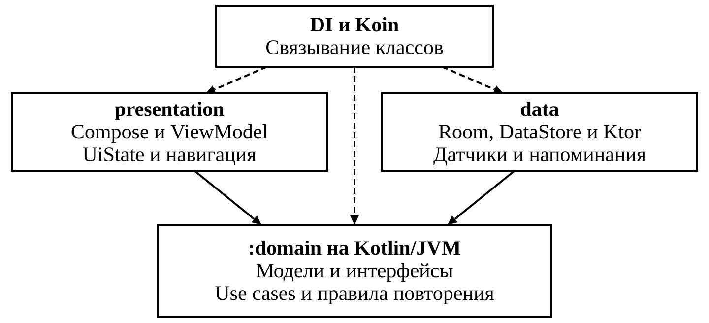

# Архитектура приложения Запомни

Практика 4. Проектирование Android-приложения и его границы с сервером каталога.

## 1 Слои и зависимости

Занятие читает карточки и сохраняет оценки на устройстве. Сервер нужен для просмотра общего каталога и скачивания наборов. Поэтому правила занятия, проверки материала и расчёт сроков размещаются в отдельном модуле `:domain` на Kotlin/JVM. Этот модуль содержит модели, интерфейсы и use cases, работает с Coroutines и Flow и собирается без Android, Room, DataStore и HTTP-клиента.

В `:app` пакет `presentation` содержит Compose, ViewModel, UiState и навигацию. Экран отправляет событие во ViewModel, она вызывает use case и возвращает новое состояние. Пакет `data` реализует интерфейсы domain, вызывает FastAPI, Room, DataStore и Android API. Сетевые DTO и сущности Room преобразуются в модели domain на границе data.

Пакет `di` внутри `:app` связывает реализации с интерфейсами через Koin. ViewModel получает use cases через конструктор. Слои presentation и data зависят от domain, а DI знает о трёх слоях. Дополнительные Gradle-модули понадобятся, если появится отдельная потребность в изоляции сборки.

Сплошные стрелки показывают зависимости presentation и data от domain. Пунктир показывает, какие слои использует DI при связывании классов.

Android-клиент читает каталог по HTTPS. FastAPI проверяет редакторский доступ к изменениям, валидирует данные и пишет в PostgreSQL. У Android-клиента нет доступа к БД сервера и редакторскому секрету. Формат API и схема сервера определяются в практике 8.

## 2 Модели и инварианты

| Модель | Данные и правила |
| --- | --- |
| Deck и Card | Набор хранит ID, название и описание. Карточка хранит ID, ID набора, вопрос, ответ и ревизию текста. ID стабилен. Одинаковые названия и тексты допустимы. |
| DeckOrigin | Собственный набор редактируется. Скачанный набор хранит ID источника и остаётся локальным снимком только для чтения. Идентификаторы локальных и серверных наборов различаются по типу. |
| ReviewSchedule | Локальное расписание карточки содержит stage от 0 до 5, dueAt и версию записи. У новой или отредактированной карточки stage равен 0, а срок наступает сразу. Изменение названия набора расписание сохраняет. |
| StudySession | ID занятия, ID локального набора, момент начала и неизменная очередь карточек. Очередь содержит снимки вопросов и ответов с ревизиями. Текущую позицию и открытие ответа хранит ViewModel. |
| ReviewEvent | ID занятия, ID набора, ID карточки, оценка и момент её принятия. Пара «ID занятия и ID карточки» уникальна. Событие хранится вместе с вычисленным сроком для безопасного повтора записи. |
| StudySummary | Число всех оценок, успешных и неуспешных. Доля успеха равна числу успешных оценок, делённому на число всех оценок. Пустая история отображается отдельным состоянием. |
| UserSettings | Тема, включение жестов и напоминаний, местные часы и минуты. Фактическая доступность датчика и уведомлений определяется Android во время работы. |

Время оценок и dueAt хранятся как миллисекунды от начала эпохи UTC. `Clock` подменяется в unit-тестах. `ScheduleRule` получает время и прежний stage, возвращает новый stage и срок по таблице ТЗ. Правило не читает системные часы и не изменяет хранилище.

Валидация материала выполняется перед записью. `MaterialValidator` удаляет внешние пробельные символы и считает Unicode code points. Название содержит 1–100 символов, описание — до 500, вопрос и ответ — по 1–1000. Внутренние пробелы и переносы сохраняются.

## 3 Интерфейсы domain

| Интерфейс | Контракт |
| --- | --- |
| CatalogReader | Читает общий каталог и содержимое серверного набора. Возвращает модели domain и ошибки запроса. Use case каталога нормализует поисковый запрос по FR01. |
| LocalDeckStore | Читает локальные наборы и карточки, редактирует собственные материалы, сохраняет снимок каталога целиком и удаляет локальные данные. Применяет изменения материала и сброс расписания в одной транзакции. |
| ReviewStore | Читает сроки и историю, ищет оценку по ключу занятия и карточки. Атомарно сохраняет оценку и расписание с проверкой ревизии карточки и ожидаемого расписания. |
| SettingsStore | Наблюдает настройки через Flow и сохраняет их согласованным обновлением. Начальное значение выключает напоминания. |
| GestureSource | Поток доступности и распознанных жестов Reveal, Remembered и NeedsReview. Подписка запускает получение событий. Отмена подписки освобождает датчик. Контракт допускает фейковые события и отсутствие датчика. |
| ReminderScheduler | Согласует единственную будущую задачу с настройками и возможностью уведомлений. Обновление времени заменяет задачу, выключение отменяет её. |
| Clock | Возвращает текущее время в миллисекундах UTC. В приложении используется системное время, в тестах — фиксированное. |

Use cases возвращают успешное значение или типизированную ошибку `AppError`. К ошибкам относятся неверные поля, отсутствие набора или карточки, запрет редактирования снимка, сбой сети, недоступность сервера, сбой локального чтения или записи и конфликт записи. Пустой каталог, пустая очередь и отсутствие датчика имеют отдельные состояния. Data преобразует ожидаемые ошибки платформы в ошибки domain и сохраняет семантику отмены корутин. Presentation сопоставляет ошибки со строками из strings.xml и доступными действиями.

## 4 Сценарии использования

### UC01 Поиск в каталоге

`SearchCatalog` (FR01) получает запрос, читает каталог через CatalogReader и фильтрует названия по подстроке без учёта регистра и внешних пробелов. Пустой запрос возвращает весь список. Если совпадений нет, экран показывает пустое состояние. Сбой чтения позволяет повторить запрос.

### UC02 Просмотр набора

`ReadDeck` (FR02) принимает ключ набора. По локальному ID читает Room через LocalDeckStore, по серверному ID обращается к CatalogReader. Возвращает название, описание и карточки либо ошибку чтения. `ObserveMyDecks` наблюдает список локальных наборов через LocalDeckStore. Локальный снимок открывается и после удаления оригинала на сервере.

### UC03 Скачивание набора

`DownloadDeck` (FR03, FR15) получает содержимое с сервера, проверяет полноту и идентификаторы, затем сохраняет набор, карточки и начальное расписание одной транзакцией. Снимок уникален по ID источника. Повторная операция возвращает имеющуюся копию с её прогрессом. Ошибка до завершения транзакции оставляет возможность повторить попытку.

### UC04 Управление своими материалами

`SaveOwnDeck` и `SaveOwnCard` (FR04–05) принимают поля и, при изменении, ID записи. Проверяют поля и принадлежность набора пользователю. Успех возвращает ID сохранённого материала. Правка вопроса или ответа увеличивает ревизию и сбрасывает срок в той же транзакции. Неверный ввод остаётся в форме. `DeleteOwnMaterial` выполняет удаление после подтверждения в UI. Удаление набора очищает его карточки, сроки и историю одной операцией. `RemoveDownloadedDeck` с тем же подтверждением удаляет локальный снимок и его прогресс.

### UC05 Начало занятия

`StartStudy` (FR06, FR15) получает ID локального набора, один раз считывает Clock и формирует очередь с dueAt не позже этого момента. Сортировка идёт по сроку и затем по стабильному ID. При пустой очереди возвращается ближайший срок, если он есть. Новые сроки учитываются при следующем старте.

### UC06 Оценка ответа

`GradeCard` (FR07–08, FR15) получает ключ занятия и карточки, ревизию текста и оценку. Повтор команды возвращает сохранённый результат. Для новой оценки GradeCard читает срок, применяет ScheduleRule и сохраняет результат через ReviewStore. После открытия ответа ViewModel принимает одну команду. При успехе она переходит дальше, при сбое сохраняет ответ и команду для повтора.

### UC07 Управление жестами

`ObserveStudyGestures` (FR09–11) получает доменные события от GestureSource. ViewModel допускает Reveal при скрытом ответе, Remembered и NeedsReview при открытом. Кнопки отправляют те же действия. При отсутствии датчика ViewModel показывает причину и оставляет кнопки доступными.

### UC08 Результаты и статистика

`ReadStatistics` (FR12) получает ID занятия для сводки или читает общую локальную историю. Считает все оценки, включая оценки одной карточки в разных занятиях. ViewModel отображает процент с одним десятичным знаком и состояние «Нет данных» при пустой истории.

### UC09 Настройки и напоминания

`ObserveSettings` и `UpdateSettings` (FR13–14) читают и сохраняют тему, жесты и время. Экран обрабатывает запрос системного разрешения на уведомления. После сохранения настроек ReminderScheduler согласует задачу с разрешением и локальным временем. При сбое планирования настройки остаются сохранёнными, а согласование можно повторить. Задача проверяет актуальные настройки и наличие карточек к повторению перед отправкой и ограничивает отправку одним уведомлением за местные сутки.

## 5 Запись оценки и жизненный цикл

RoomReviewStore проверяет уникальный ключ оценки внутри транзакции. Для повтора уже сохранённой команды возвращает сохранённый результат. Другая оценка с тем же ключом даёт конфликт. Для новой команды сравнивает ревизию текста и версию расписания, затем вместе записывает событие и обновляет срок. При изменившейся карточке ViewModel предлагает начать занятие заново. Повтор после сбоя подтверждения использует тот же ключ и не добавляет второе событие.

StudyViewModel хранит очередь и фазу «вопрос», «ответ», «сохранение», «ошибка сохранения» или «итог». Поворот экрана сохраняет фазу и позицию. Кнопка и жест проходят через один обработчик. Пока идёт запись, второй ввод игнорируется. События от старой карточки или остановленной подписки отбрасываются по идентификатору активной карточки и подписки.

Подписка активна, когда экран занятия на переднем плане, жесты включены и карточка ожидает ввода. SensorGestureSource переводит координаты в ориентацию экрана и распознаёт удержание и возврат в нейтральное положение. При выходе в фон, повороте или переходе к следующей карточке подписка останавливается, распознаватель начинает с новой нейтральной позиции. Очередь может быть потеряна при уничтожении процесса, подтверждённые оценки остаются в Room.

## 6 Экраны и состояния

Каждый экран имеет свою пару ViewModel и UiState. Экран получает состояние и отправляет действия. Данные для навигации передаются по типизированным ID, а дочерние формы остаются состояниями редактора.

| Экран | ViewModel и UiState | Основная работа |
| --- | --- | --- |
| Каталог | CatalogViewModel, CatalogUiState | Запрос, список, пусто, повтор чтения |
| Мои наборы | MyDecksViewModel, MyDecksUiState | Локальные наборы, подтверждение удаления |
| Содержимое набора | DeckDetailsViewModel, DeckDetailsUiState | Просмотр, скачивание, запуск занятия |
| Редактор | MaterialEditorViewModel, MaterialEditorUiState | Ввод, ошибки полей и сохранения |
| Занятие | StudyViewModel, StudyUiState | Очередь, ответ, оценка, доступность жестов |
| Результаты и статистика | StatisticsViewModel, StatisticsUiState | Итог занятия, история, нет данных |
| Настройки | SettingsViewModel, SettingsUiState | Тема, жесты, напоминания, доступность уведомлений |

Проверки при реализации охватывают границу срока, отсутствие карточек, сброс stage, скачивание без частичного снимка, повтор записи после сбоя, смену ориентации и управление без датчика. Критерии успеха и ошибок берутся из A01–A15. Серверный контракт FR16 проверяется отдельно после реализации API.

## 7 Принципы SOLID

| Принцип | Реализация | Объяснение |
| --- | --- | --- |
| SRP | ScheduleRule рассчитывает stage и dueAt. | Изменение алгоритма локализовано в правиле. Запись выполняет RoomReviewStore, форматирование выполняет ViewModel. |
| OCP | ObserveStudyGestures принимает GestureSource. | Новый способ распознавания можно подключить через другую реализацию источника. Обработка доменных действий Reveal, Remembered и NeedsReview сохраняется. |
| LSP | RoomReviewStore и тестовый InMemoryReviewStore реализуют ReviewStore. | Обе реализации соблюдают атомарность записи, конфликт при несовпадении версии и повтор с тем же ключом. GradeCard работает с обеими по одному контракту. |
| ISP | SearchCatalog использует CatalogReader, GradeCard использует ReviewStore. | Клиент каталога получает операции чтения. Обработчику оценки доступны операции расписания и истории. Объединение этих методов потребовало бы лишних зависимостей от каждого клиента. |
| DIP | GradeCard принимает Clock и ReviewStore в конструкторе. | Правило оценки зависит от интерфейсов domain. Koin подставляет системный источник времени и реализацию на Room, а JVM-тест передаёт фейки. |
