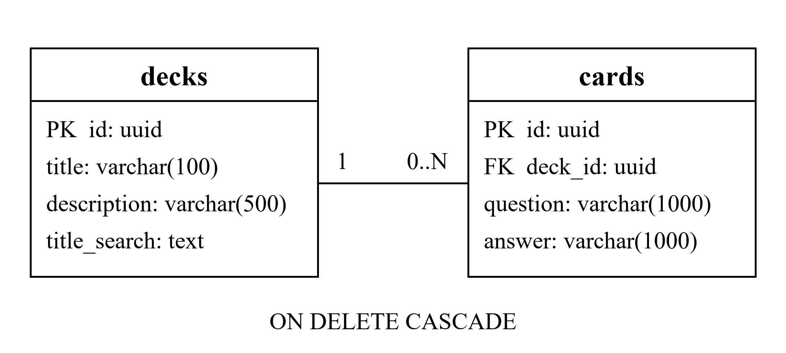

# Практика 8 Проектирование API каталога

Сервер хранит общий каталог для поиска и скачивания наборов. Изменения в каталоге выполняет редактор. Собственные наборы, история занятий и настройки учащегося хранятся на телефоне.

## Модель данных каталога

Наборы и карточки получают UUID. У набора может быть пустой список карточек. Индексируемый внешний ключ cards.deck_id закрепляет карточку за одним набором. Удаление набора каскадно удаляет карточки в PostgreSQL. Скачанные копии доступны на телефоне.

Название набора содержит от 1 до 100 символов, описание — до 500, вопрос и ответ — от 1 до 1000. Сервер удаляет внешние пробелы перед проверкой длины. Внутренние пробелы и переносы в карточках сохраняются. Названия и тексты могут совпадать. Записи различаются по ID.

Сервер хранит нормализованное через Unicode casefold название в title_search для поиска буквальной подстроки. Пустой запрос возвращает весь каталог. Набор и карточки для скачивания читаются из одного снимка БД.

<!-- pagebreak -->

## Операции каталога

Все пути начинаются с **/api/v1**. Полный контракт хранится в **backend/openapi.yaml**.

| Путь | Операции и коды успеха |
| --- | --- |
| /decks | GET 200 — найти наборы. POST 201 — создать пустой набор. |
| /decks/{deck_id} | GET 200 — скачать набор. PUT 200 — заменить название и описание. DELETE 204 — удалить набор. |
| /decks/{deck_id}/cards | POST 201 — добавить карточку. |
| /decks/{deck_id}/cards/{card_id} | GET 200 — прочитать карточку. PUT 200 — заменить вопрос и ответ. DELETE 204 — удалить карточку. |

PUT заменяет изменяемые поля целиком и сохраняет карточки набора. Карточка должна принадлежать набору из пути. Ответ 201 содержит адрес записи в Location. Ответ 204 возвращается без тела.

## Доступ редактора

GET доступен без ключа. Для POST, PUT и DELETE редактор передаёт **X-Editor-Key** по HTTPS. FastAPI извлекает заголовок через APIKeyHeader. Сервер сравнивает его со значением **EDITOR_API_KEY** из окружения через secrets.compare_digest.

Пропущенный и неверный ключ дают 401. При пустой настройке сервера запись возвращает 503. Редактор хранит ключ в приватном окружении своего клиента. В APK, Git и журналы значение ключа не попадает.

<!-- pagebreak -->

## Примеры запросов и ответов

**Поиск.** GET /api/v1/decks?q=столицы возвращает 200. При отсутствии совпадений тело содержит {"items": []}. Пример совпадения приведён ниже.

{"items": [{"id": "356f61bb-a918-4e0f-8cd8-369c1f0e318a", "title": "Столицы Европы", "description": "Тренировка по географии", "card_count": 1}]}

**Создание.** POST /api/v1/decks с установленным X-Editor-Key и типом application/json принимает следующее тело.

{"title": "Столицы Европы", "description": "Тренировка по географии"}

Ответ 201 содержит Location с адресом набора и тело с выданным ID. У только что созданного набора список карточек пуст.

{"id": "356f61bb-a918-4e0f-8cd8-369c1f0e318a", "title": "Столицы Европы", "description": "Тренировка по географии", "cards": []}

**Ошибка доступа.** Тот же запрос без ключа возвращает 401 и заголовок WWW-Authenticate со значением APIKey.

{"error": {"code": "editor_required", "message": "Требуется доступ редактора."}}

В общем формате ошибок error.code предназначен для обработки в клиенте, error.message — для пояснения. Некорректные поля дают 422 с массивом error.fields. Отсутствующая запись даёт 404. Коды 500 и 503 используются для серверных сбоев и временной недоступности.

## Справочные материалы

[Спецификация OpenAPI 3.1](https://spec.openapis.org/oas/v3.1.0.html), [документация FastAPI по безопасности](https://fastapi.tiangolo.com/reference/security/), [ограничения PostgreSQL](https://www.postgresql.org/docs/18/ddl-constraints.html).
